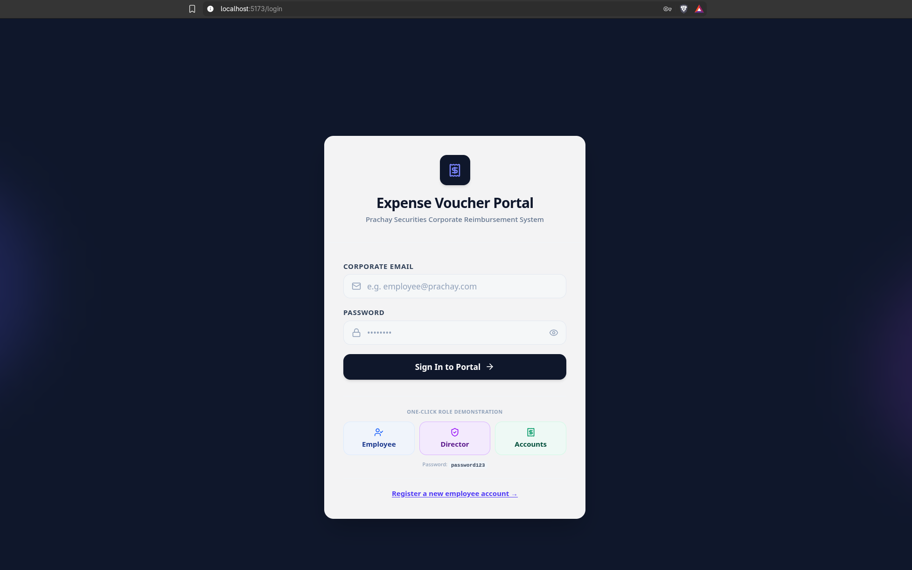
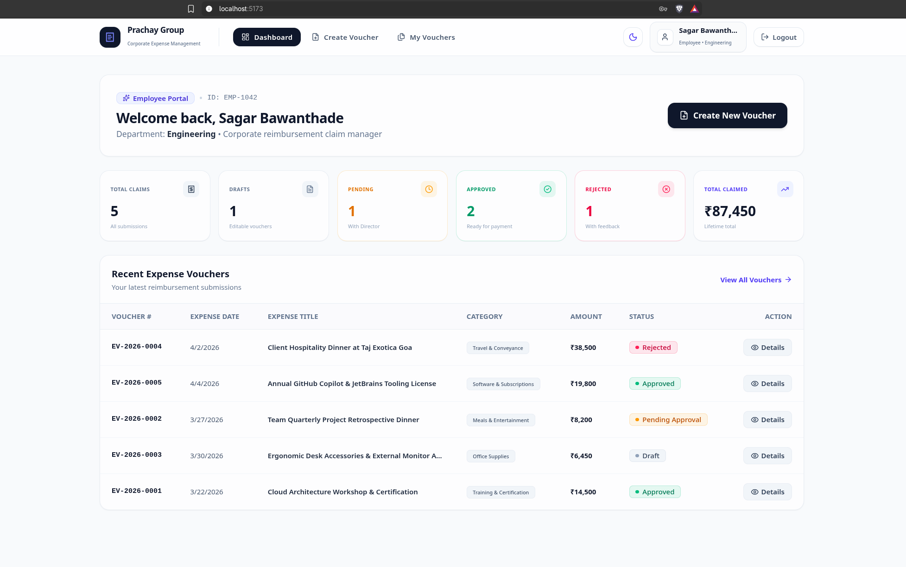
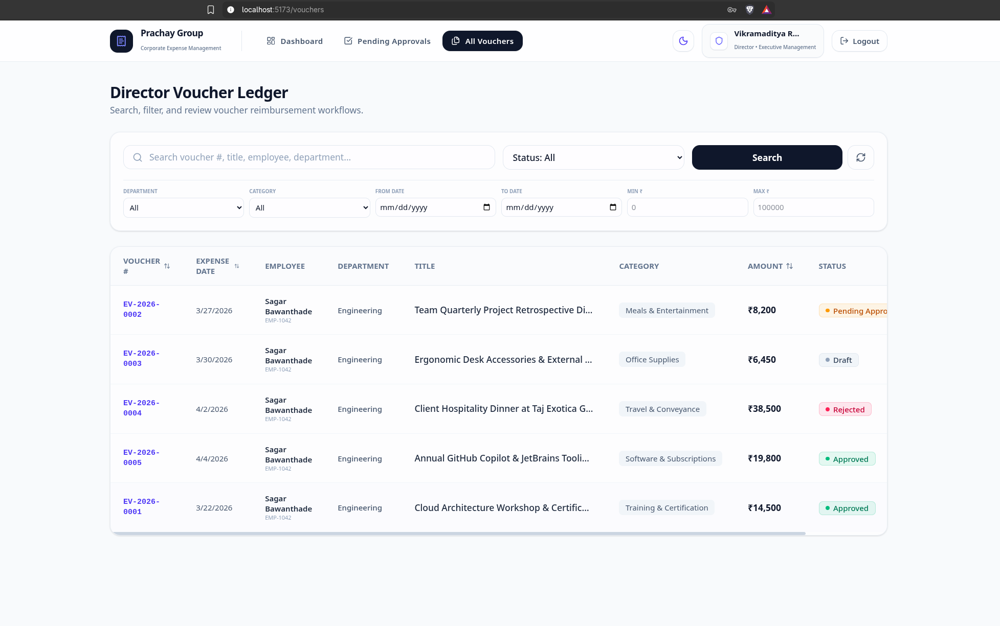
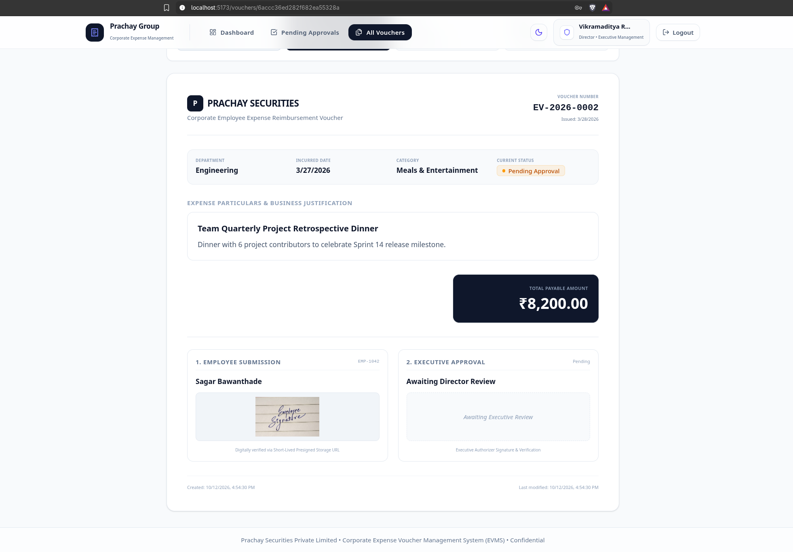
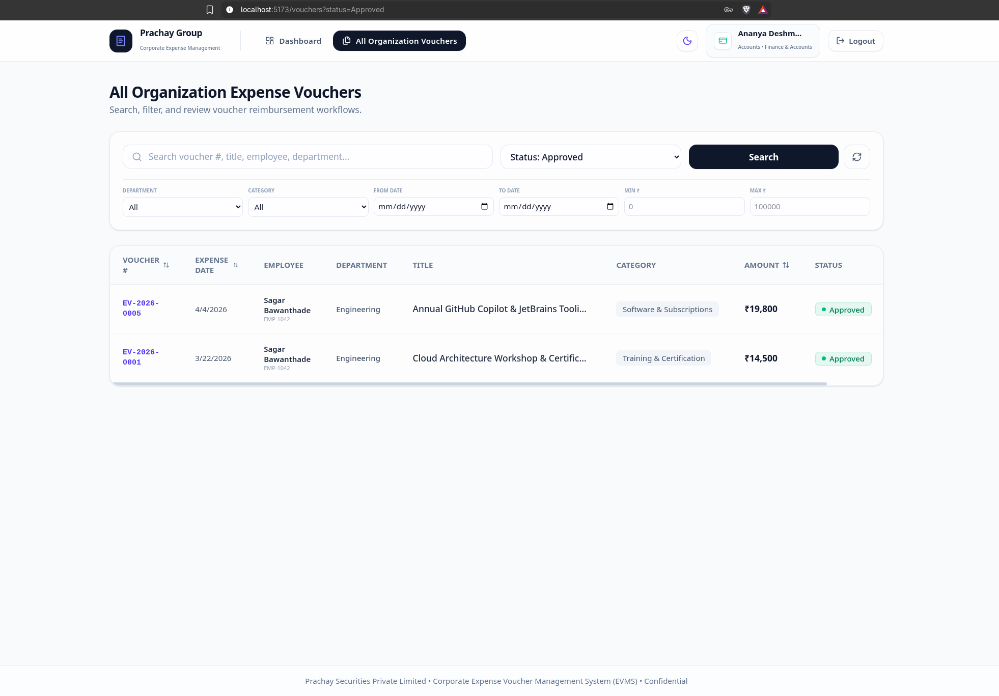

# 🧾 Prachay Corporate Expense Voucher Management System (EVMS)

A production-ready Full Stack web application engineered to digitize employee expense reimbursements, Director approvals, and Accounts Team settlement monitoring. Built with clean architecture, enterprise role-based authorization, and secure AWS S3 private digital signature storage with presigned URLs.

> 🌐 **Live Custom Domain (HTTPS)**: [https://prachay.kodesesh.space](https://prachay.kodesesh.space)  
> 🔗 **Backend API Health Check**: [https://prachay.kodesesh.space/api/health](https://prachay.kodesesh.space/api/health)  
> 🖥️ **Direct VPS Mirror**: [http://167.86.127.138:5173](http://167.86.127.138:5173)

---

## 📑 Table of Contents
1. [Application Screenshots](#-application-screenshots)
2. [Tech Stack](#-tech-stack)
3. [Key Features & Role-Based Workflows](#-key-features--role-based-workflows)
4. [Architecture & Design Decisions](#-architecture--design-decisions)
5. [Database Schema Explanation](#-database-schema-explanation)
6. [AWS S3 & Presigned URL Architecture](#-aws-s3--presigned-url-architecture)
7. [API Documentation](#-api-documentation)
8. [Installation & Setup Guide](#-installation--setup-guide)
9. [Demo Credentials](#-demo-credentials)
10. [Assumptions Made](#-assumptions-made)
11. [Deployment Instructions](#-deployment-instructions)

---

## 📸 Application Screenshots

### 1. Authentication & Role Switcher
One-click instant switch for Employee, Director, and Accounts evaluation, plus corporate email registration:


### 2. Employee Dashboard & Expense Claims
Real-time claim status counters, total reimbursement metrics, and quick voucher access:


### 3. Director Voucher Ledger & Multi-Filter Search
Executive review screen with search by keyword, status, category, date range, and amount:


### 4. Voucher Audit Details with Live AWS S3 Digital Signature
Detailed financial voucher sheet displaying handwritten digital signatures securely delivered via short-lived AWS S3 presigned URLs:


### 5. Accounts Team Reimbursement Monitor
Organization-wide financial ledger filtered for Approved claims ready for payment processing:


---

## 💻 Tech Stack

- **Frontend**: React 19, Vite, Tailwind CSS v4, Lucide React icons, React Router DOM v7, Axios
- **Backend**: Node.js, Express.js (ES6 JavaScript modules)
- **Database**: MongoDB & Mongoose ORM (with automatic MongoMemoryServer fallback for effortless zero-config evaluation)
- **Authentication**: Stateless JSON Web Tokens (JWT) & bcryptjs password hashing
- **File Storage**: Amazon S3 (AWS SDK for JavaScript v3 `@aws-sdk/client-s3` & `@aws-sdk/s3-request-presigner`) with secure tokenized local fallback
- **File Upload**: Multer memory storage (streaming directly to S3 / secure storage)

---

## 👥 Key Features & Role-Based Workflows

### 1. User Roles & Permissions

| Feature / Permission | Employee | Director (Admin) | Accounts Team |
|---|:---:|:---:|:---:|
| **Login & Session Management** | ✅ | ✅ | ✅ |
| **Create & Save Draft Voucher** | ✅ | ❌ | ❌ |
| **Edit / Delete Draft Voucher** | ✅ | ❌ | ❌ |
| **Upload Digital Signature** | ✅ (On submission) | ✅ (On approval) | ❌ |
| **Submit Voucher for Approval** | ✅ | ❌ | ❌ |
| **View Own Vouchers** | ✅ | ✅ | ✅ |
| **View Organization Vouchers** | ❌ (Own only) | ✅ (All) | ✅ (All) |
| **Approve Voucher with Signature** | ❌ | ✅ | ❌ |
| **Reject Voucher with Remarks** | ❌ | ✅ (Mandatory reason) | ❌ |
| **Monitor Reimbursement Queue** | ❌ | ❌ | ✅ |
| **Print / PDF Voucher Sheet** | ✅ | ✅ | ✅ |

### 2. Voucher Lifecycle Workflow
```
Draft
 │  (Employee can edit, delete, update signature)
 ▼
Submitted
 │  (Locked; pending Director review)
 ├───► Rejected (Mandatory rejection reason; visible to employee)
 │
 ▼
Approved
 │  (Director digital signature attached)
 ▼
Accounts Team Queue (Reimbursement processing & disbursement)
```

---

## 🗄️ Database Schema Explanation

### `User` Schema
Represents system users across departments and hierarchical roles:
- `name` (String, required): Full employee or executive name.
- `email` (String, required, unique, lowercase): Corporate email used for authentication.
- `password` (String, required): Bcrypt-hashed password (cost factor 10, never exposed in queries).
- `role` (String, enum: `['Employee', 'Director', 'Accounts']`): Determines access permissions.
- `department` (String): Department name (e.g., Engineering, Finance, HR).
- `employeeId` (String): Corporate identifier (e.g., `EMP-1042`).
- `timestamps`: Automatic `createdAt` and `updatedAt`.

### `Voucher` Schema
Stores complete financial and audit details:
- `voucherNumber` (String, unique, indexed): Auto-generated unique voucher ID (format: `EV-YYYY-XXXX`).
- `voucherDate` (Date): Date the voucher was registered in the system.
- `expenseDate` (Date, required): Date when the expense was actually incurred.
- `department` (String, required): Department responsible for the expense.
- `title` (String, required): Purpose or title of the reimbursement claim.
- `category` (String, enum): Standard categories (`Travel & Conveyance`, `Meals & Entertainment`, `Office Supplies`, `Software & Subscriptions`, `Hardware & Equipment`, `Training & Certification`, `Client Meeting`, `Medical & Health`, `Utilities`, `Other`).
- `description` (String): Itemized explanation or justification.
- `amount` (Number, required, min: 0.01): Claimed amount in INR.
- `status` (String, enum: `['Draft', 'Submitted', 'Approved', 'Rejected']`).
- `employee` (`ObjectId -> User`): Reference to creating employee.
- `employeeName` & `employeeId`: Cached at time of creation for audit consistency.
- `employeeSignatureKey` (String): Secure S3 key or local storage reference for employee's signature.
- `approvedBy` (`ObjectId -> User`): Reference to approving Director.
- `directorName`: Cached Director name upon review.
- `directorSignatureKey` (String): Secure S3 key or local reference for Director's signature.
- `approvalDate` (Date): Timestamp when decision was recorded.
- `rejectionReason` (String): Mandatory explanation if rejected.

---

## ☁️ AWS S3 & Presigned URL Architecture

### Why Private S3 + Presigned URLs?
Signatures are sensitive executive and employee assets that must not be exposed in public S3 buckets.
1. **Private Bucket**: Objects are uploaded to AWS S3 with private access control.
2. **Presigned GET URLs**: When an authenticated user requests voucher details, the backend generates a short-lived presigned URL (`getSignedUrl` from `@aws-sdk/s3-request-presigner`) with a 15-minute expiration (`expiresIn: 900`).
3. **Seamless Local Fallback**: When AWS credentials are not configured in `.env`, the system transparently utilizes a secure local signature repository and serves it via an authenticated streaming endpoint (`/api/signatures/view/:filename`).

---

## 📡 API Documentation

### 1. Authentication Endpoints

#### `POST /api/auth/login`
- **Body**: `{ "email": "employee@prachay.com", "password": "password123" }`
- **Response**: JWT token and user profile object.

#### `POST /api/auth/register`
- **Body**: `{ "name", "email", "password", "role", "department", "employeeId" }`

#### `GET /api/auth/me`
- **Headers**: `Authorization: Bearer <token>`
- **Response**: Currently authenticated user profile.

---

### 2. Voucher Endpoints

#### `GET /api/vouchers`
- **Headers**: `Authorization: Bearer <token>`
- **Query Params**: `search`, `status`, `department`, `category`, `startDate`, `endDate`, `minAmount`, `maxAmount`, `sortBy`, `order`, `page`, `limit`
- **Role Isolation**: Employees receive only their own vouchers. Directors and Accounts receive organization-wide records. Presigned signature URLs are attached.

#### `GET /api/vouchers/:id`
- **Headers**: `Authorization: Bearer <token>`
- **Response**: Single voucher with populated presigned URLs and audit timestamps.

#### `POST /api/vouchers` (Role: Employee)
- **Headers**: `Authorization: Bearer <token>`, `Content-Type: multipart/form-data`
- **Body Fields**: `department`, `title`, `expenseDate`, `category`, `description`, `amount`, `action` (`draft` | `submit`), `signature` (File)
- **Validations**: Employee signature is strictly enforced when `action === 'submit'`.

#### `PUT /api/vouchers/:id` (Role: Employee)
- **Headers**: `Authorization: Bearer <token>`, `Content-Type: multipart/form-data`
- **Validation**: Only editable while status is `Draft`. Locked once submitted.

#### `DELETE /api/vouchers/:id` (Role: Employee)
- **Validation**: Deletion only allowed in `Draft` status.

#### `POST /api/vouchers/:id/review` (Role: Director)
- **Headers**: `Authorization: Bearer <token>`, `Content-Type: multipart/form-data`
- **Body Fields**: `decision` (`Approve` | `Reject`), `rejectionReason` (required if rejecting), `signature` (File, required if approving).

#### `GET /api/vouchers/dashboard-stats`
- **Role-tailored metrics**:
  - **Employee**: Total, Drafts, Pending, Approved, Rejected, Total Claimed Amount.
  - **Director**: Pending Approval Count, Approved Today, Rejected Today, Total Pending Value, Recent Activity.
  - **Accounts**: Total, Pending, Approved, Rejected, Total Approved Outflow Amount, Recent Approved list.

---

## 🚀 Installation & Setup Guide

### Prerequisites
- Node.js (v18.x or v20.x+) or Docker & Docker Compose
- npm (v9.x+)

---

### 🐳 One-Command Docker Deployment (Instant Live Stack)
Run the entire production stack (Nginx SPA Frontend + Express Backend + Atlas/S3 Cloud Connectivity) in isolated Docker containers:

```bash
# 1. Build and launch all services in detached mode:
docker compose up --build -d

# 2. Open the application:
# Frontend Web App: http://localhost:5173
# Backend API Endpoint: http://localhost:5001/api/health
```

To view logs or stop the containers:
```bash
docker compose logs -f
docker compose down
```

---

### 💻 Manual Local Development (Without Docker)
1. Clone the repository:
   ```bash
   git clone https://github.com/SagarBawanthade/Prachay-Group-FullStack-Assignment.git
   cd Prachay-Group-FullStack-Assignment
   ```

2. Install dependencies for both backend and frontend:
   ```bash
   npm run install:all
   ```

3. Start the Backend API server (Runs on port 5001 with automatic DB seeder):
   ```bash
   cd server
   npm run dev
   ```

4. Start the Frontend React application (Runs on http://localhost:5173):
   ```bash
   cd client
   npm run dev
   ```

5. Open your browser at `http://localhost:5173`.

---

## 🔑 Demo Credentials

Quick one-click login buttons are provided directly on the Login page for convenience during evaluation:

| Role | Email | Password |
|---|---|---|
| **Employee** | `employee@prachay.com` | `password123` |
| **Director** | `director@prachay.com` | `password123` |
| **Accounts Team** | `accounts@prachay.com` | `password123` |

---

## 🛠️ Environment Variables Configuration

### Server (`server/.env`):
```env
PORT=5001
MONGODB_URI=mongodb://127.0.0.1:27017/expense_voucher_db
JWT_SECRET=super_secret_jwt_key_prachay_voucher_2026
CLIENT_URL=http://localhost:5173

# Optional: AWS S3 Storage (Leave empty to use automatic local storage fallback)
AWS_REGION=us-east-1
AWS_S3_BUCKET_NAME=
AWS_ACCESS_KEY_ID=
AWS_SECRET_ACCESS_KEY=
```

### Client (`client/.env`):
```env
VITE_API_URL=http://localhost:5001/api
```

---

## 💡 Assumptions Made

1. **Auto-fallback Database**: To ensure evaluators can test the app immediately without needing a local MongoDB daemon installed, the server includes a built-in MongoMemoryServer fallback.
2. **Sequential Unique Voucher IDs**: Formatted as `EV-YYYY-XXXX` where `YYYY` is the current year and `XXXX` combines sequential count and a random salt to prevent collisions.
3. **Data Immutability**: Submitted vouchers cannot be modified by the employee or the Director (only approved or rejected) to preserve financial compliance.
4. **Signature Security**: Stored privately with short-lived presigned URLs (15 minutes expiration).

---

## 🚢 Deployment Instructions

### Frontend (Vercel / Netlify)
1. Set build command: `npm run build`
2. Set output directory: `dist`
3. Configure Environment Variable: `VITE_API_URL=https://your-backend-api.com/api`

### Backend (Render / Railway / AWS ECS)
1. Set start command: `npm start`
2. Configure Environment Variables: `PORT`, `MONGODB_URI`, `JWT_SECRET`, `CLIENT_URL`, and optional AWS S3 credentials.
